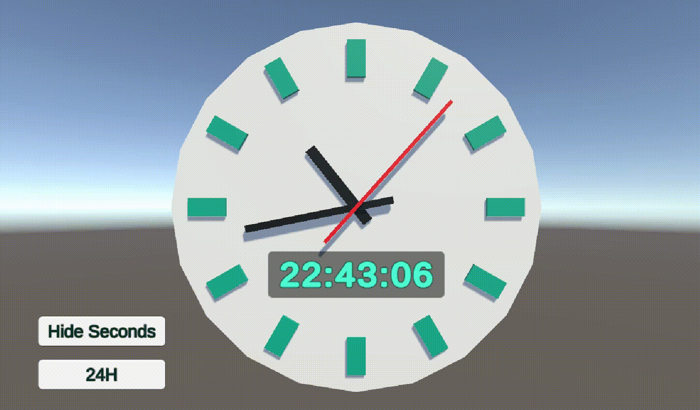

# Unity Clock Project

A 3D analog clock built in Unity while following the Catlike Coding Basics tutorial, then extended with additional features beyond the original tutorial.

## Tutorial

Catlike Coding – Game Objects and Scripts  
https://catlikecoding.com/unity/tutorials/basics/game-objects-and-scripts/

---

## Features

- Real-time analog clock synchronized with the system clock
- Animated hour, minute, and second hands
- Digital clock using TextMeshPro
- Toggle second hand visibility
- Switch between 12-hour and 24-hour formats
- Simple interactive UI controls

---

## What I Learned

### Unity Fundamentals
- GameObjects & Components
- MonoBehaviour lifecycle
- Transform hierarchy
- Scene organization

### Programming
- C# scripting
- Working with system time
- Structuring scripts
- Controller pattern

### Mathematics
- Euler angles
- Quaternion rotations
- Converting time into rotation angles

### UI
- Canvas
- Buttons
- TextMeshPro
- Event-driven UI

---

## Architecture

```text
UI Buttons
      │
      ▼
ClockController
   ├──────────────┐
   ▼              ▼
Analog Clock   Digital Clock
```

The UI communicates only with `ClockController`, which manages both clock systems and keeps them synchronized.

---

## Screenshots
<p align="center">

 
  </p>


### Full View



