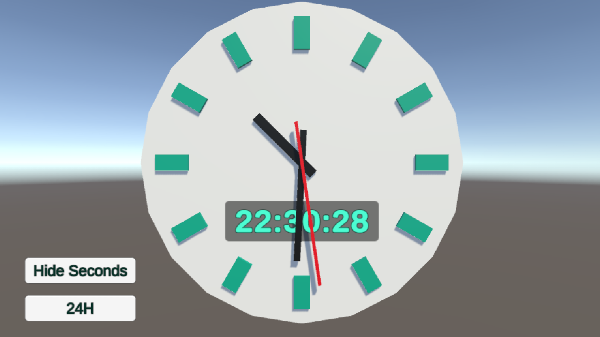
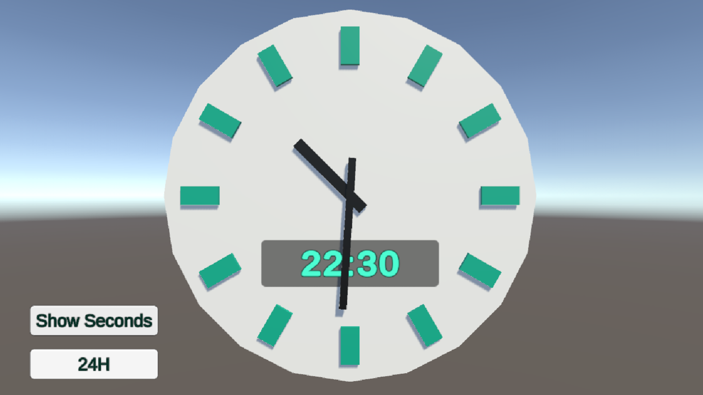
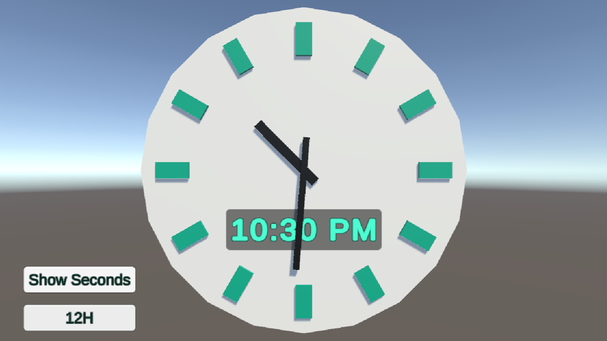

# Unity Clock Project

A 3D analog clock project built in Unity, extended with a digital display and interactive UI controls.

## Based On

Tutorial:
https://catlikecoding.com/unity/tutorials/basics/game-objects-and-scripts/

## Features

- Real-time analog clock using system time
- Rotating hour, minute, and second hands
- Digital clock display using TextMeshPro
- Toggle seconds visibility (analog + digital)
- Switch between 12-hour and 24-hour time formats
- Interactive UI buttons

## What I Learned

### Unity Basics
- Creating and managing GameObjects
- Working with Components
- Using MonoBehaviour lifecycle methods
- Scene organization

### Mathematics & Transformations
- Working with Transform components
- Understanding rotations
- Using Quaternion.Euler for rotations
- Mapping time values to rotation angles

### UI Development
- Creating Canvas-based UI
- Using TextMeshPro
- Connecting buttons with script methods
- Managing UI state changes

## Architecture

The project uses a simple controller-based architecture:
Button
↓
ClockController
↓
├── Clock (Analog)
└── DigitalClock (Digital)
The UI does not directly control individual clock components. Instead, `ClockController` manages communication between systems.

## Notes

یشبث

## Screenshots

